# wf — wireframes as YAML

Write a screen in YAML, get a clickable greyscale wireframe you can open in a
browser, hand to a client, or embed in your own app. No canvas, no dragging, no
design file. The whole element library, the box rules and the proportions live
in the engine, so an agent or a person writes intent and the renderer decides
what it looks like.

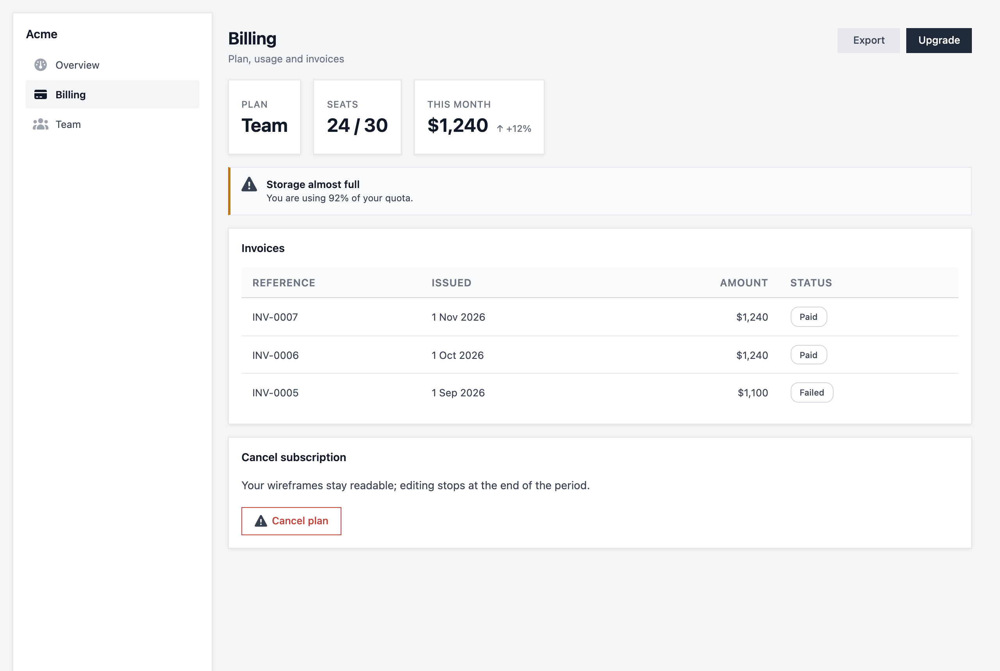

That screenshot is [`examples/quickstart`](examples/quickstart) — one page of
YAML, rendered by `wf build`. Every image in this README is generated from a
real project in this repo by `node scripts/update-readme-screenshots.js`, so
none of them can drift from what the renderer actually does.

---

## Why

Wireframing tools assume a human with a mouse. This one assumes whoever is
writing the screen — person or agent — would rather describe it:

- **54 elements**, one for every common UI part. You never build a card out of a
  bordered section, or a nav out of buttons.
- **The engine decides the boxes.** The hardest part of a wireframe is knowing
  which containers are real panels and which only organise layout. That is a
  rule system here, not a judgement call, and `wf why` tells you which rule fired.
- **Greyscale on purpose**, with four hues reserved for severity.
- **Deterministic.** Same input, same output, byte for byte. No randomness, no
  timestamps — wireframes diff cleanly in review.
- **Clickable.** Routes, overlays, state and interactions work in the built HTML.
- **Three platforms.** Web, iOS and Android chrome from the same elements.

---

## Install

```bash
pnpm install
```

```bash
node cli/bin/wf.js --help
```

## Quick start

```bash
node cli/bin/wf.js init my-app
```

```bash
cd my-app && node ../cli/bin/wf.js build --output ./build
```

Open `build/web/index.html`. To follow the screenshot above instead:

```bash
cd examples/quickstart && node ../../cli/bin/wf.js build
```

---

## A page, start to finish

A project is a folder of YAML documents: a `manifest`, a `sitemap` of routes, a
`templates` file holding the shell, and one file per page. The template says
where things go; the page says what they are.

The shell — a sidebar that sizes itself and a slot for the page:

```yaml
templates:
  app:
    layout: { type: row, gap: 0, padding: 0, align: stretch }
    regions:
      - id: sidebar
        kind: persistent
        role: sidebar        # 256px on web, 220 on tablet, never shrinks
        children:
          - id: menu
            component: nav
            props:
              items:
                - label: Overview
                - label: Billing
                  active: true
      - id: main
        kind: slot
        role: main
```

The page — note that `row` groups without drawing anything, while each `stat`
and `card` inside it frames itself:

```yaml
page:
  id: billing
  template: app
  slots:
    - slotId: main
      content:
        - id: header
          component: page_header
          props:
            title: Billing
            actions:
              - label: Export
              - label: Upgrade
                variant: primary

        - id: summary
          use: plan_summary         # a reusable component, defined once

        - id: quota
          component: alert          # hue, because this is a severity
          props:
            title: Storage almost full
            text: You are using 92% of your quota.
            variant: warning

        - id: invoices
          component: card
          props: { title: Invoices }
          children:
            - id: invoice_table
              component: table
              props:
                columns:
                  - { label: Reference, key: reference }
                  - { label: Amount, key: amount, align: right }
                  - { label: Status, key: status, kind: badge }
                rows:
                  - { reference: INV-0007, amount: $1,240, status: Paid }
                  - { reference: INV-0005, amount: $1,100, status: Failed }
```

The full file is [`examples/quickstart/pages/billing.yaml`](examples/quickstart/pages/billing.yaml).

---

## Components and links

**A component is declared once in `components.yaml` and used by id.** `{{props.x}}`
reads what the calling node passes; `propDefaults` fills the rest.

```yaml
components:
  plan_summary:
    propDefaults: { plan: Team, seats: 24 / 30, spend: $1,240 }
    root:
      id: plan_summary_root
      component: row
      props: { gap: 16 }
      children:
        - id: plan_summary_plan
          component: stat
          props: { label: Plan, value: "{{props.plan}}" }
```

```yaml
- id: summary
  use: plan_summary
  props: { spend: $1,240 }    # override one, keep the rest
```

**Pages link by route id, never by file path.** A `sitemap.yaml` names the
routes; `route:` on a nav item and `targetRoute` on an interaction point at
them. Rename a page and nothing else moves.

```yaml
- id: menu
  component: nav
  props:
    items:
      - { label: Overview, icon: gauge, route: overview }
      - { label: Billing, icon: credit-card, route: billing }
      - { label: Team, icon: users, route: team }
```

```yaml
- id: go_billing
  component: button
  props: { label: See invoices, variant: primary }
  interaction:
    - type: navigation
      targetRoute: billing
```

A sidebar lives in the template and is rendered once per page, so it cannot know
which page it is on. The renderer marks the item pointing at the current route —
you never hand-set `active:`, and it can never go stale.

```bash
node cli/bin/wf.js routes
```

```
overview / -> page overview / template app
billing /billing -> page billing / template app
team /team -> page team / template app
```

Set `basePath` to `..` in `.wfrc.yaml` and a build is clickable straight from
the filesystem; leave it at `/` for a site served from its root.

[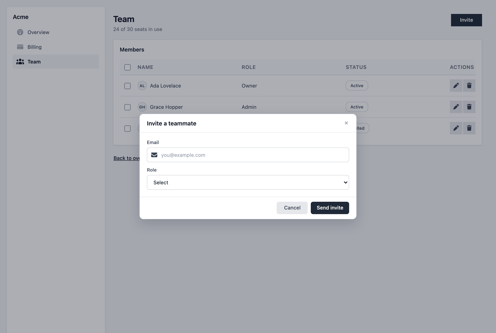](examples/quickstart)

Three pages, one shared sidebar, one component used twice, one modal — the
example builds to something you can actually click through.

---

## The box rule

This is the part most wireframe output gets wrong: everything ends up in a box,
or nothing does. Here the frame is a decision with ten steps, shared by the
renderer and the linter so they can never disagree.

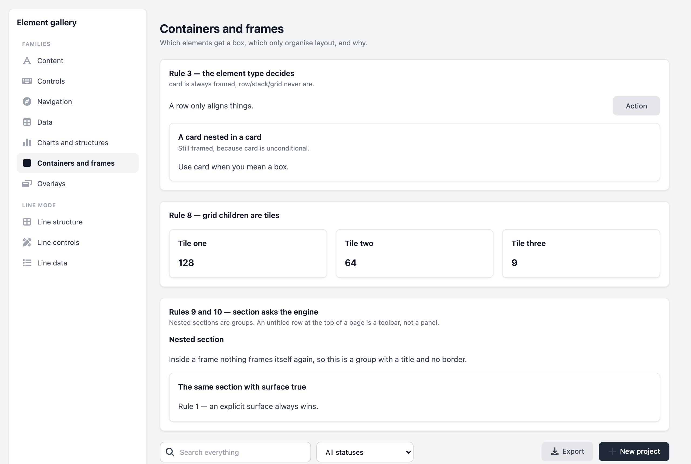

1. `surface: true` / `surface: false` on the node wins over everything.
2. A border in `wireframeStyle` means you want a box.
3. The element type decides — `card`, `alert`, `code`, `upload`, `editor`,
   `calendar`, `picker` always box; `row`, `stack`, `grid`, `split`, `form`
   never do; `tab_bar`, `app_bar`, `divider` draw one edge.
4. Overlay chrome owns the frame, so overlay content never double-boxes.
5. Template regions box unless they are a slot or `role: main`.
6. A pane is a panel, so it boxes.
7. If the parent separates its children, the parent draws the strokes.
8. Grid children are tiles, so they box.
9. Inside a box, nothing boxes itself again.
10. At the top of a page a `section` boxes — unless it is an untitled row, which
    reads as a toolbar.

Every node in the output carries `data-wf-frame` (`surface`, `group`, `control`,
`content` or `edge`), so you can read the decision back out of the HTML. When
you disagree with one:

```bash
node cli/bin/wf.js why stats --page billing
```

```
stats — <row> on page "billing"
Frame:  group (no box)
Rule:   3 — the element type always renders this way
Reason: element:row
To change it: `row` always renders this way. Set `surface: true` or
`surface: false` to override, or pick a different element.
```

`section` means "engine, you decide". `card`, `row`, `stack` and `grid` are
explicit — reach for those when you already know.

---

## Elements

54 of them, in six families.

| Family | Elements |
|---|---|
| **containers** | section, card, stack, row, grid, split, form, carousel |
| **text** | heading, paragraph, text, code, badge, avatar, icon, image, rating, stat, progress, skeleton, divider, spacer, empty_state |
| **controls** | button, segmented, input, textarea, select, checkbox, radio, toggle, choice_group, tags_input, upload, picker, editor |
| **navigation** | tab_bar, bottom_tab_bar, breadcrumb, pagination, stepper, nav, menu, app_bar, action_sheet, page_header |
| **data** | table, list, chart, calendar, kanban, tree, accordion |
| **feedback** | alert |

`input` alone covers 14 types; `chart` draws 10 shapes; `list` has six shapes
including chat and timeline; `table` has typed columns with selection, sorting,
and loading and empty states.

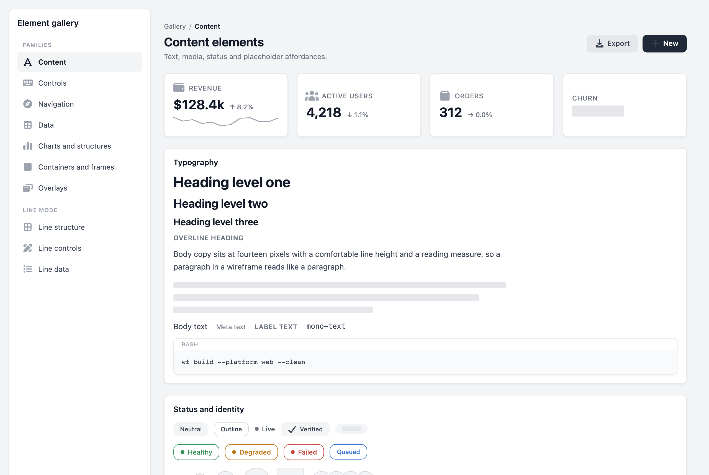

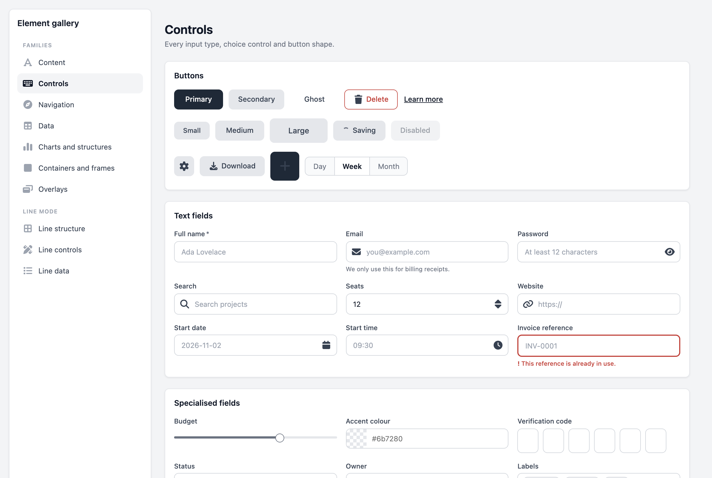

Leave the text out of anything and it renders a placeholder bar rather than a
gap — which is what a wireframe should show.

### The catalogue

Every element, rendered, with its props, its example and the box rule it obeys:
**[docs/catalogue/index.html](docs/catalogue/index.html)** — open it from a
checkout, no build step.

[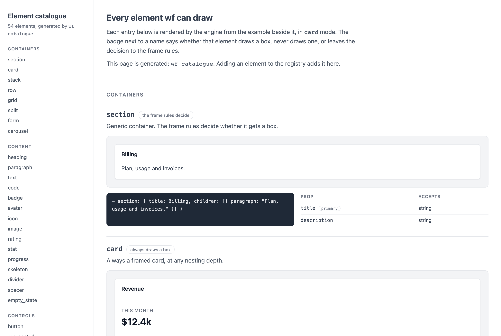](docs/catalogue/index.html)

The page is generated, and a test fails if the committed copy drifts from what
the generator produces:

```bash
node cli/bin/wf.js catalogue --out docs/catalogue
```

The element set is declared once, in `engine/schema/primitive-registry/`, and
that single source generates the JSON Schema, the lint contracts, the renderer
dispatch, the agent reference and that catalogue. Adding an element to the
registry adds it everywhere. Ask the CLI rather than reading the code:

```bash
node cli/bin/wf.js llm --element table
```

---

## Colour

The wireframe is greyscale. Four hues exist and they answer exactly one
question — how bad is this:

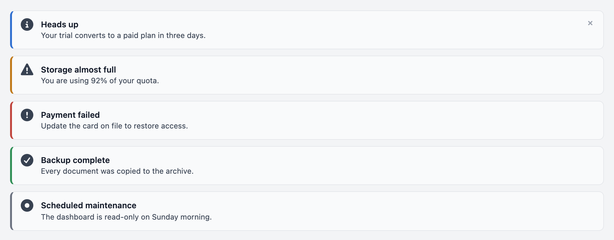

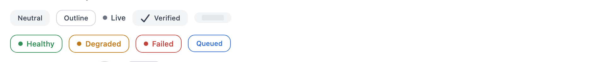

| Element | Ask for it with | What takes the hue |
|---|---|---|
| `alert` | `variant: info \| success \| warning \| error` | the left stripe |
| `badge` | `tone: info \| success \| warning \| danger` | the pill's border, label and dot |
| `button` | `variant: danger` | the outline and label |
| any field | `error: <message>` | the control's border and the message |
| `menu` / `action_sheet` row | `danger: true` | the label |

Nothing else takes one. Charts, `stat` trends, headings, primary buttons and
every fill stay grey on purpose — `up` is not green, because a rising churn rate
is not good news, and a wireframe that colours by brand or by category has
stopped being a wireframe. A test fails if a hue reaches any other selector.

---

## Two modes

`renderMode: card` is a greyscale product mock — white surfaces, soft shadows,
rounded corners. `renderMode: line` is a blueprint — strokes and dashes, no
fills. Same YAML, same elements.

| `card` | `line` |
|---|---|
| 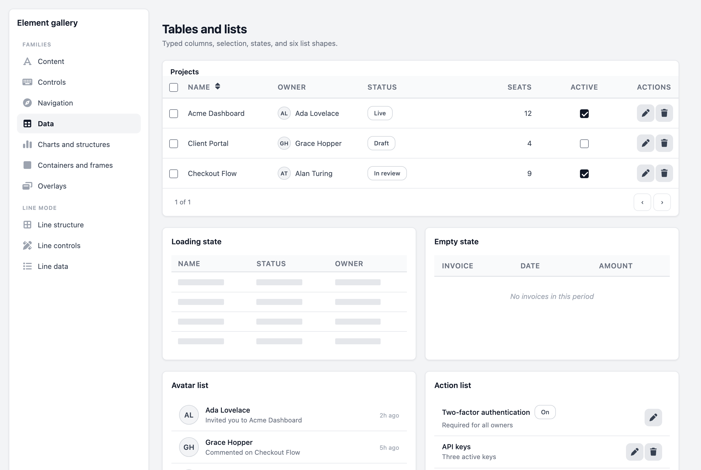 | 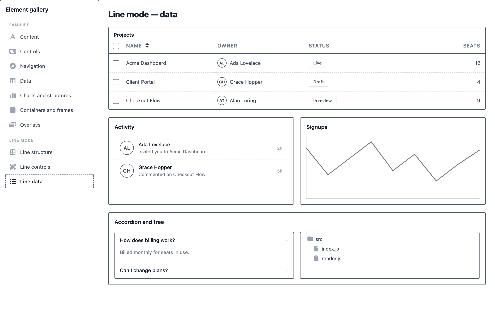 |

---

## Mobile

Set `viewport.platform` to `ios` or `android`. The elements do not change — only
the chrome a native user expects: control heights, corner radii, where the title
sits, the status bar, the home indicator.

| iOS | Android | A menu, anchored |
|---|---|---|
| 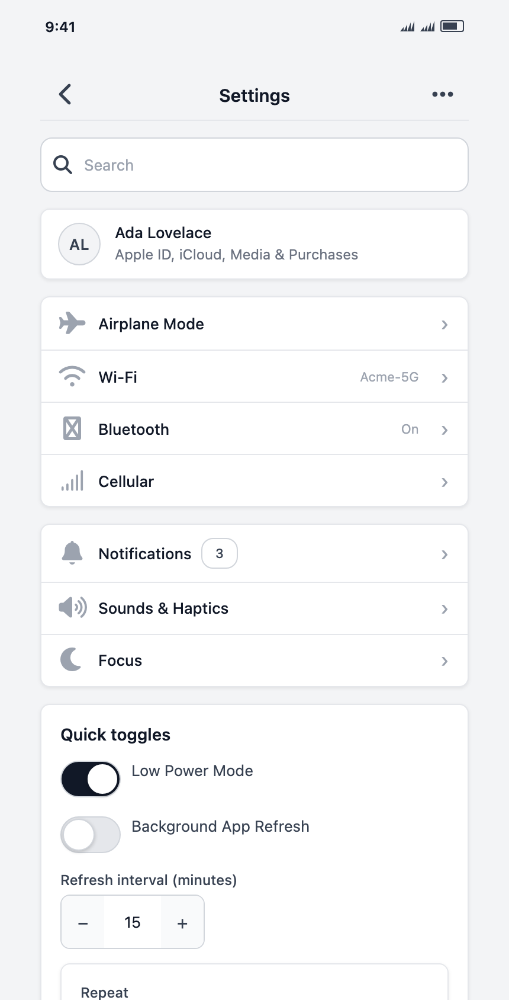 | 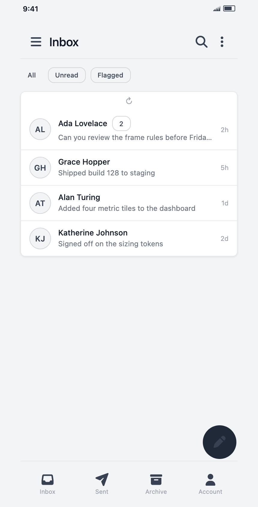 | 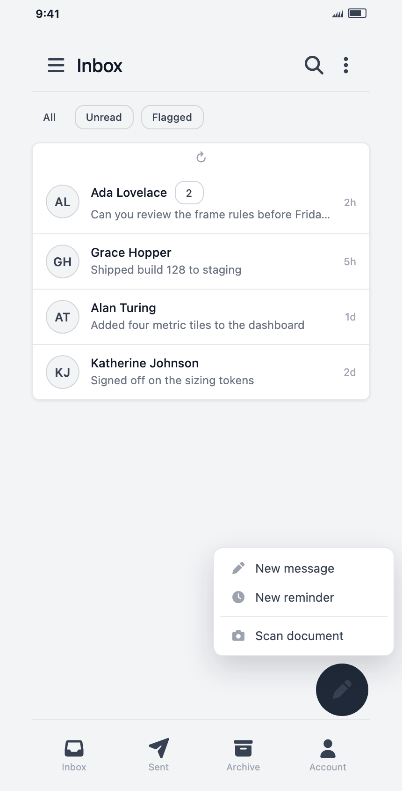 |

```yaml
viewport:
  device: mobile
  orientation: portrait
  platform: android
```

Native-only elements: `app_bar`, `bottom_tab_bar`, `action_sheet`, `picker`,
`list` with `kind: settings`, `input` with `inputType: stepper`, and `button`
with `fab: true`. Bottom chrome docks to the foot of the device and a floating
action button clears it on its own.

---

## Popups, dropdowns and dialogs

Overlays live in `page.overlays` (or `template.overlays`) and open from an
interaction. Anchored types position themselves against their trigger at
runtime, flip when they would overflow the viewport, and match the trigger's
width.

```yaml
- id: open_menu
  component: button
  props: { label: Actions }
  interaction:
    - type: open_overlay
      targetOverlay: actions_menu

overlays:
  - id: actions_menu
    type: menu            # modal alert dropdown popover menu
                          # drawer_left drawer_right bottom_sheet toast tooltip
    trigger: open_menu    # anchors the popup to that node
    placement: bottom
    dismissOn: [outside, escape]
    content:
      - id: actions_list
        component: menu
        props:
          items: [Rename, Duplicate, { label: Delete, danger: true }]
```

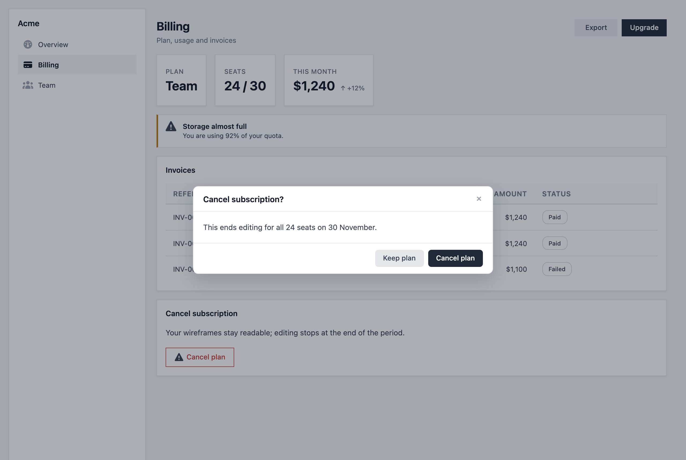

---

## Proportions

Give a region a `role` and it sizes itself: `header`, `app_bar`, `sidebar`,
`nav`, `main`, `aside`, `footer`, `toolbar`, `tabbar`, `form`, `dialog`,
`sheet`, `drawer`, `content`. A `role: sidebar` is 256px on web, 220 on tablet,
280 on mobile, with a minimum and no shrink.

There are exactly three places to override a size, and no theming system:

```yaml
manifest:
  sizing:
    sidebar.width: 280      # 1. project-wide
```

```yaml
- id: filters
  component: card
  size: { width: 320 }      # 2. this node
```

```yaml
rendering:
  density: compact          # 3. the whole page, scaled
```

---

## One file, and the browser

`wf pack` folds a whole project into a single `.wf` file — a multi-document YAML
stream, losslessly, byte-identical on repeat runs.

```bash
node cli/bin/wf.js pack --out acme.wf
```

```bash
node cli/bin/wf.js unpack acme.wf --out ./acme
```

The renderer runs entirely in the browser, so a host app can open a `.wf` with
no server:

```js
import { parseWf, createWireframe } from '@wireframes/renderer';

const project = parseWf(await file.text());
const wf = createWireframe(document.getElementById('host'), project, {
  onNavigate: (routeId) => console.log('went to', routeId),
});

wf.setPage('billing');
wf.setMode('line');
wf.setPlatform('ios');
wf.explain('sidebar');    // { frame: 'surface', rule: 5, reason: 'region:sidebar' }
```

It mounts into a sandboxed iframe, so the wireframe's stylesheet and runtime
cannot reach the host. Navigation comes back as a `wf:navigate` message.
Ships as ESM and as a script tag exposing `window.Wireframes`; the build fails
if the bundle outgrows its size budget.

---

## Commands

| Command | What it answers |
|---|---|
| `wf init <name>` | scaffold a project |
| `wf validate` | schema and semantic errors, each with an address |
| `wf lint` | the mistakes people actually make, each with a suggestion |
| `wf why <node> --page <page>` | why that node did or did not get a box |
| `wf llm --short` | the whole element reference, generated from the code |
| `wf catalogue` | the element catalogue page, rendered |
| `wf tree <page>` | the resolved page tree |
| `wf inspect <address>` | the resolved node at an address |
| `wf build` | static HTML you can open |
| `wf serve` | local preview with hot reload |
| `wf screenshots` | rendered PNGs |
| `wf pack` / `wf unpack` | one `.wf` file in, a project folder out |
| `wf routes`, `wf stats`, `wf where-used` | project queries |

Also `page`, `template`, `component`, `node`, `overlay`, `state` and `data` for
editing a project without opening a file.

```bash
node cli/bin/wf.js --help
```

Commands are declared once in `cli/commands/registry.js`, so `wf --help`,
`wf help <command>` and `wf <command> --help` all come from the same place and a
test fails if a command ships undocumented. Asking for help never runs the
command.

---

## Examples in this repo

| Project | What it is |
|---|---|
| [`examples/quickstart`](examples/quickstart) | three linked pages, a shared component, a modal |
| [`admin_wireframes`](admin_wireframes) | the admin panel, 15 pages |
| [`wireframe_studio`](wireframe_studio) | the online editor |
| [`web_wireframes`](web_wireframes) | the marketing site |
| [`engine/renderer/__fixtures__/gallery`](engine/renderer/__fixtures__/gallery) | every element, every frame rule, both modes, all three platforms |

---

## Layout

```
engine/     the shared engine — no CLI, API or framework dependencies
cli/        the wf command, a thin layer over the engine
renderer/   the browser bundle: parse a .wf, mount it, drive it
api/        Bun + PostgreSQL API
admin/      React editor
web/        landing page
docs/       everything below
examples/   runnable example projects
```

The engine never touches the filesystem — the CLI builds a document map from
disk and the API builds one from Postgres, and the engine does not care which.

## Development

```bash
pnpm test
```

Engine and CLI — 205 tests, including the Playwright checks. `pnpm test:all`
adds the renderer, web and admin suites.

```bash
pnpm gallery:update
```

```bash
pnpm readme:update
```

Renderer changes need a Playwright check: the gallery is pixel-compared against
committed baselines, and layout contracts (bottom chrome docking, no horizontal
overflow) are asserted directly.

## Documentation

| Document | Covers |
|---|---|
| [docs/cli/agent-guide.md](docs/cli/agent-guide.md) | element cheat sheet, box rules, proportions — written for agents, generated by `wf llm --short` |
| [docs/cli/schema.md](docs/cli/schema.md) | document types and the node model |
| [docs/cli/schema-systems.md](docs/cli/schema-systems.md) | layout, state, interactions, overlays, validation |
| [docs/cli/rendering.md](docs/cli/rendering.md) | build, serve and the renderer |
| [docs/cli/rendering-modes.md](docs/cli/rendering-modes.md) | line vs card, and the colour rule |
| [docs/cli/wf-format.md](docs/cli/wf-format.md) | the `.wf` container and the browser renderer |
| [docs/architecture.md](docs/architecture.md) | engine, CLI, API, admin, web |
| [AGENTS.md](AGENTS.md) | the rules this repo is built under |
