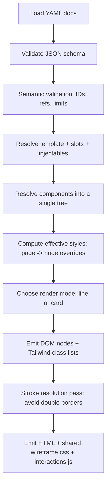

# Rendering Wireframes from YAML in Two Modes

## Executive summary

Low‑fidelity wireframes are most effective when they keep attention on structure, hierarchy, and user flow rather than polish. Guidance from entity["organization","Nielsen Norman Group","ux research firm"] and entity["company","Figma","design software company"] consistently frames low‑fidelity work as simplified, grayscale representations using basic shapes and minimal typographic variation, specifically to accelerate iteration and focus critique on layout and interaction rather than aesthetics. citeturn1search3turn1search18turn1search12

For your two rendering modes, the “double border” problem is best treated as a **rendering responsibility**, not something authors have to micromanage per node. The robust pattern is:

- Treat **space (gap)** as a first‑class, schema‑driven layout feature and render it with CSS `gap` (grid/flex) rather than margins, so the “in‑between” is always intentional and visible. citeturn0search14turn0search24turn9search1  
- When two sibling boxes must be visually separated **without a gap**, do **not** draw borders on both boxes; instead draw a **single divider** at the parent level (Tailwind `divide-x`/`divide-y`) or via a systematic “only one side draws the stroke” rule. Tailwind’s divider utilities implement this “between children” approach explicitly. citeturn4view2turn4view3  
- In greyscale card mode, your intuition is correct: a light grey page background plus white cards makes borders between adjacent cards largely redundant; separation is carried by **background contrast + gap gutters + subtle elevation**, a pattern echoed in surface/elevation guidance in Material and platform design guidance in general. citeturn1search1turn1search27  

Your current schema already has strong foundations for this: `layout.gap`, `layout.padding`, layout types (stack/row/grid), an overlay system, and a per‑page `wireframeStyle` system.     
What’s missing for “proper” rendering across two modes is primarily (a) explicit **render mode / theme token** configuration and (b) a few schema/validator tweaks so responsive spacing and separators are consistently expressible.

## Visual language for the two modes

A reliable wireframe renderer needs a small, explicit “visual language” so the output is consistent across pages and authors. Below is a practical, renderer‑friendly vocabulary that stays low‑fidelity while being deterministic.

### Token sets

Use a **single token system** shared by both modes; each mode then maps those tokens to different CSS variables / Tailwind class recipes.

**Spacing tokens (4px base)**  
This aligns with common UI spacing practice and maps cleanly to Tailwind’s default spacing scale.

| Token | px | Typical use |
|---:|---:|---|
| `s0` | 0 | flush adjacency (rare; tables, segmented controls) |
| `s1` | 4 | tight internal padding, icon gaps |
| `s2` | 8 | default “touch separation” in dense areas |
| `s3` | 12 | comfortable inner padding, small card gaps |
| `s4` | 16 | default layout gap between cards/sections |
| `s6` | 24 | major section spacing |
| `s8` | 32 | page‑level spacing blocks |

**Stroke tokens (single‑stroke discipline)**

| Token | CSS meaning | When used |
|---|---|---|
| `hairline` | 1px stroke | default outlines/dividers |
| `emphasis` | 2px stroke | key containers (rare), selected state |

CSS borders are part of the box model; outlines are painted “over” the box and don’t cause reflow. For wireframe emphasis (hover/selected/focus), outlines are often preferable because they don’t shift layout. citeturn4view1turn3search6turn3search5

**Radius tokens**

| Token | line mode | card mode |
|---|---:|---:|
| `r0` | 0 | 0–4 |
| `r2` | 2 | 8 |
| `r3` | 4 | 12 |

In pure‑line mode, sharp corners reinforce “blueprint” feel; in card mode, rounded corners signal surfaces.

**Typography tokens (minimal scale)**  
Low‑fidelity guidance typically recommends grayscale and a limited set of typographic variations. citeturn1search18turn1search12

| Role | Size | Weight | Notes |
|---|---:|---:|---|
| `title` | 18–20px | 600 | page/section titles |
| `body` | 14–16px | 400 | default text |
| `meta` | 12–13px | 400 | labels, helper text |

**Iconography tokens (wireframe‑safe)**

| Token | Rendering |
|---|---|
| `icon_stub` | simple square/circle glyph (no brand icons) |
| `chevron` | `>` marker for selects/menus |
| `avatar_stub` | circle with initials |

### Component boundary rules

To address your “everything got a box” complaint directly:

- **Only “surfaces” get full bounds** (sections/cards/modals/panes/forms).  
- **Controls do not always get boxes** in pure‑line mode: buttons can render as label + subtle underline/brackets, while inputs/selects typically need a boundary because otherwise they are ambiguous as fields.  
- **Dividers are separate from boxes**: represent adjacency with a single divider line rather than two touching box borders.

This matches the intent of low‑fidelity work: recognition and hierarchy, not complete visual fidelity. citeturn1search3turn1search18

## Rendering space and avoiding double borders

Your core scenario—two cards/sections next to each other—has exactly three “correct” separation strategies. The renderer can choose automatically based on context (mode + layout rules + gap).

### Strategy one: gutter space

This is the cleanest approach for both modes, and especially for card mode.

- Use parent layout `gap` to make the in‑between space explicit and stable.  
- In card mode, set the page background to light grey and cards to white; the gap reveals the grey “gutter”, so no internal dividers are required.

CSS `gap` is defined for grid and flex layouts; it avoids per‑child margin hacks and keeps spacing consistent. citeturn0search14turn0search24turn9search1


### Strategy two: parent dividers

When two items must be flush (gap = 0) but still separated by a line, draw **exactly one** line between them:

- A parent “divider system” draws separators *between* children.
- Tailwind’s `divide-x` / `divide-y` does this by applying a border only to “not last child” (and has reverse helpers). citeturn4view2turn4view3

This avoids the 2px “double stroke” entirely.

### Strategy three: single‑sided borders

When you need more custom control than `divide-*` (for example, only certain siblings have separators, or complex nested patterns), implement a deterministic rule:

- In a row: only draw `border-left` on children except the first (or only `border-right` on children except the last).  
- In a stack: only draw `border-top` on children except the first.  

This is equivalent to `divide-*` in spirit, but you own the selector logic.

### Outline vs border

Outlines are painted “over” the element and don’t affect layout or cause reflow when toggled. That makes them excellent for selection/focus states and “inspect mode” highlighting in your renderer. citeturn4view1turn3search8turn3search5  
Borders, by contrast, participate in box sizing; switching border thickness can shift layout unless you compensate. citeturn3search6turn3search12  

In practical wireframe rendering:

- Use **borders** for structural lines you want to be part of the geometry (e.g., a card’s frame).  
- Use **outlines / rings** for transient emphasis (selected, hovered, focus). This also maps well to Tailwind’s outline utilities and box‑shadow utilities. citeturn9search0turn3search3turn0search1

### Emerging standards: gap decorations

A brand‑new CSS Working Draft introduces “gap decorations” for grid/flex gutters (properties like `row-rule` and `column-rule` plus overlap control), essentially standardising “draw separators in the gap, not on the boxes”. This is directly relevant to your “space in between” problem, but as a draft it should be treated as experimental until widely implemented. citeturn4view0turn6view0  

For a production‑grade renderer today, emulate this behaviour with `divide-*` or pseudo‑elements; keep gap decorations on your radar as a future simplification.

### Small SVG examples

#### Naïve double border vs single divider

```svg
<svg width="720" height="170" viewBox="0 0 720 170" xmlns="http://www.w3.org/2000/svg">
  <rect x="0" y="0" width="720" height="170" fill="#fff"/>
  <text x="20" y="24" font-family="system-ui, sans-serif" font-size="14" fill="#111">Naïve: borders on both boxes (double stroke)</text>
  <rect x="20" y="40" width="150" height="100" fill="none" stroke="#333" stroke-width="2"/>
  <rect x="170" y="40" width="150" height="100" fill="none" stroke="#333" stroke-width="2"/>
  <text x="75" y="97" font-family="system-ui, sans-serif" font-size="12" fill="#333">A</text>
  <text x="225" y="97" font-family="system-ui, sans-serif" font-size="12" fill="#333">B</text>

  <text x="360" y="24" font-family="system-ui, sans-serif" font-size="14" fill="#111">Fix: parent frame + single divider</text>
  <rect x="360" y="40" width="320" height="100" fill="none" stroke="#333" stroke-width="2"/>
  <line x1="520" y1="40" x2="520" y2="140" stroke="#333" stroke-width="2"/>
  <text x="435" y="97" font-family="system-ui, sans-serif" font-size="12" fill="#333">A</text>
  <text x="595" y="97" font-family="system-ui, sans-serif" font-size="12" fill="#333">B</text>
</svg>
```

## Component definitions and schema recommendations

### What your current schema already enables

Your current spec is structurally strong: it defines a deterministic node tree with layout primitives, sizing, grid placement, overlays, panes, visibility conditions, and a per‑page wireframe style contract.     
Notably for the “spacing between two cards” problem:

- `layout.gap` exists and should be the canonical way to represent spacing.   
- `divider` and `spacer` primitives exist for explicit separation when needed.   
- `wireframeStyle` exists (border style/width, corner style/radius), but it is currently too small to fully describe card mode’s surface/background/elevation.    

### What’s missing for “proper” two‑mode rendering

The missing pieces are mostly about **render configuration and tokens**, not about adding ad‑hoc styling to every node.

#### Recommended additions (minimal but high impact)

**Add a theme/tokens document type (recommended)**  
Keep YAML as the primary format, but separate structure from presentation. Add a new doc type, e.g. `documentType: theme`, that provides:

- token scales (spacing, radii, stroke, type)
- mode mappings (`line` vs `card`)
- palette variables (grey page background vs white surfaces)

This preserves your schema’s “no production styling” principle while still making rendering deterministic.

**Add `page.rendering` to select mode + theme**  
So a page can declare:

- which mode to render (`line` or `card`)
- which theme token set to use
- density (compact/comfortable) if desired

**Extend responsiveness overrides**  
Your `responsive.allowedOverrides` list currently omits `padding` and `columns` even though they are core layout fields. In practical UI, both are frequently responsive, and without them authors will emulate with spacers or extra wrappers. Recommend adding at least `padding` and `columns` to allowed overrides (and likely `justify`).    

**Tighten `layout.align` / `layout.justify` values**  
They are currently free strings. Consider enumerations aligned to flex/grid alignment keywords, because invalid values will silently degrade and harm determinism. The CSS Box Alignment module is the normative reference for alignment behaviours. citeturn0search24  

#### Add separator intent at the layout level

To solve “gap vs divider” consistently without author micromanagement, add:

- `layout.separators: none | between`  
- `layout.separatorStyle: solid | dashed`  
- `layout.separatorWhenGapZero: true|false`  

This lets you enforce the rule:  
**If `gap > 0`, use gutters. If `gap == 0` and separators requested, use parent dividers.**

### Component rendering definitions

Below are component definitions expressed as **rendering behaviour** for each mode, plus example YAML fields using your existing node model. Where your schema doesn’t have a primitive (e.g. “card”), treat it as a reusable component in `components.yaml`. 

#### Cards and sections

**Intent**: surfaces that group content.

- **Card mode**: white surface on light grey background, rounded corners, subtle shadow, internal padding; dividers inside the card are allowed (e.g. `divide-y`) but avoid nested “card within card” unless explicitly requested. Material emphasises elevation and surface treatment as the mechanism for layering. citeturn1search1turn1search27  
- **Pure‑line mode**: single hairline outline for the *card surface only*; internal structure should prefer spacing and dividers over nested boxes.

Example (page content with two cards in a row):

```yaml
- id: cards_row
  component: section
  props: { title: "Overview" }
  layout:
    type: row
    gap: 16
  children:
    - id: card_a
      use: card
      props: { title: "Card A" }
    - id: card_b
      use: card
      props: { title: "Card B" }
```

#### Buttons

**Intent**: primary actions. Your schema defines `button` with `props.label`.   

- **Card mode**: filled greyscale button with clear hit area. The HIG explicitly calls out minimum hit region guidance (44×44pt) for buttons, which is a good sanity check even in prototypes. citeturn2search0  
- **Pure‑line mode**: do **not** automatically draw a full button rectangle if you want a very “blueprint” style. Instead:
  - render label with bracket/underline convention (e.g. `[Save]`)
  - render a focus/selection outline when interactive/focused (outline doesn’t reflow). citeturn4view1turn3search8  

Example:

```yaml
- id: save_btn
  component: button
  props: { label: "Save" }
  interaction:
    - type: submit
      formId: settings_form
```

#### Inputs, selects, textareas

These need a boundary in both modes to stay recognisable as fields.

- For accessibility, boundaries that convey component affordance are subject to non‑text contrast expectations (3:1 against adjacent colours for essential UI component visuals). citeturn0search3turn0search7  
- Card mode: neutral border + subtle background or inset ring. Tailwind provides border and inset ring/shadow utilities. citeturn9search34turn0search1  
- Pure‑line: single hairline rectangle or underline‑style field with placeholder text.

Example:

```yaml
- id: email_field
  component: input
  props:
    placeholder: "Email"
    inputType: email
  accessibility:
    label: "Email address"
```

#### Lists

Your schema doesn’t define a `list` primitive; implement as a reusable component (recommended) or add a primitive later if you need semantic guarantees.

Wireframe rendering rules:

- Card mode: list items separated with `divide-y` and comfortable row padding. citeturn4view2turn4view3  
- Pure‑line: list items separated with single dividers or whitespace; avoid boxing each row.

Example list component (conceptual):

```yaml
components:
  list:
    root:
      id: root
      component: section
      layout: { type: stack, gap: 0 }
      children:
        - id: item_1
          component: text
          props: { text: "{{item.label}}" }
```

(You would need a collection/repeater mechanism to render `{{item.*}}` over datasets; your schema has dataset binding primitives but no explicit “repeater list” primitive, so consider adding one if lists/tables are a core use case. )

#### Images

Your schema defines `image` with `src/alt/width/height`.   
Wireframe rendering typically displays:

- a framed rectangle
- a simple diagonal cross or “image” label
- alt text as caption (optional)

Example:

```yaml
- id: hero_image
  component: image
  props:
    src: "assets/hero.png"
    alt: "Hero image"
    width: 640
    height: 320
```

#### Dividers and spacers

You already have `divider` and `spacer`.   

- Divider: 1px hairline; prefer parent `divide-*` when it’s “between children” rather than authored nodes everywhere.  
- Spacer: maps directly to vertical rhythm tokens.

Example:

```yaml
- id: divider_1
  component: divider
- id: spacer_1
  component: spacer
  props: { size: 24 }
```

### Recommended complete YAML example

This is a compact, end‑to‑end example showing a page selecting a render mode and using tokenised spacing. It assumes you add a `theme` doc type and `page.rendering`.

```yaml
# theme.yaml (new recommended doc type)
documentType: theme
specVersion: "1.2"
id: default_theme

theme:
  tokens:
    spacing:
      base: 4
      scale: { s0: 0, s1: 4, s2: 8, s3: 12, s4: 16, s6: 24, s8: 32 }
    stroke:
      hairline: 1
      emphasis: 2
    radius:
      r0: 0
      r2: 4
      r3: 12
    type:
      body: 14
      title: 18
      meta: 12

  modes:
    line:
      pageBg: "#ffffff"
      surfaceBg: "transparent"
      surfaceStroke: "#4b5563"   # grey-600
      surfaceStrokeWidth: hairline
      dividerStroke: "#9ca3af"    # grey-400
      buttons:
        style: "bracket_label"
    card:
      pageBg: "#f3f4f6"           # grey-100
      surfaceBg: "#ffffff"
      surfaceStroke: "#e5e7eb"    # grey-200 (optional)
      surfaceShadow: "sm"
      buttons:
        style: "filled_grey"
```

```yaml
# pages/dashboard.yaml
documentType: page
specVersion: "1.2"
id: dashboard

page:
  id: dashboard
  template: app_shell
  viewport: { device: web }
  wireframeStyle:
    border: { style: solid, width: thin }
    corner: { style: rounded, radius: 12 }

  rendering:
    mode: card          # card | line
    themeRef: default_theme
    density: comfortable

  slots:
    - slotId: main
      content:
        - id: cards_row
          component: section
          props: { title: "KPIs" }
          layout: { type: grid, columns: 12, gap: 16, padding: 16 }
          children:
            - id: kpi_a
              use: card
              gridItem: { span: 6 }
              children:
                - id: title
                  component: heading
                  props: { level: 3, text: "Revenue" }
                - id: action
                  component: button
                  props: { label: "Details" }
            - id: kpi_b
              use: card
              gridItem: { span: 6 }
              children:
                - id: title
                  component: heading
                  props: { level: 3, text: "Orders" }
                - id: action
                  component: button
                  props: { label: "Details" }
```

## Tailwind implementation patterns for both modes

Tailwind’s utility approach is explicitly about composing single‑purpose classes in markup, which fits a YAML→DOM renderer because you can deterministically map node properties to class lists. citeturn9search36turn3search17  

### Base mode wrappers

Use one root wrapper class for mode switching, and set tokens as CSS variables once per page.

**Root container approach**

```html
<body class="wf wf-mode-card">
  <div id="app"></div>
</body>
```

Then in `wireframe.css` (your build contract already includes a shared CSS file). 

```css
.wf { font-family: system-ui, sans-serif; }
.wf-mode-line {
  --wf-page-bg: #fff;
  --wf-surface-bg: transparent;
  --wf-stroke: #4b5563;
  --wf-divider: #9ca3af;
}
.wf-mode-card {
  --wf-page-bg: #f3f4f6;
  --wf-surface-bg: #fff;
  --wf-stroke: #e5e7eb;
  --wf-divider: #e5e7eb;
}
```

### Card mode “grey background + white cards” recipe

This is directly aligned with your stated intention: gutters do the work.

- Page background: `bg-gray-100` or similar. Tailwind background utilities support `bg-white` etc and map directly to `background-color`. citeturn9search3turn9search15  
- Card: white surface + radius + subtle shadow. Tailwind shadow utilities define elevation via `box-shadow`. citeturn0search1  
- Layout gaps: `gap-*` so the grey shows through gutters. Tailwind’s gap utilities cover grid/flex gutters. citeturn9search1  

Example “two cards next to each other”:

```html
<div class="min-h-screen bg-gray-100 p-6">
  <div class="grid grid-cols-2 gap-6">
    <section class="rounded-xl bg-white shadow-sm p-5">
      <h3 class="text-gray-900 text-base font-semibold">Card A</h3>
      <div class="mt-4 h-3 w-2/3 bg-gray-200 rounded"></div>
      <button class="mt-6 inline-flex items-center justify-center rounded-lg bg-gray-200 px-3 py-2 text-sm text-gray-800">
        Button
      </button>
    </section>

    <section class="rounded-xl bg-white shadow-sm p-5">
      <!-- ... -->
    </section>
  </div>
</div>
```

### Pure‑line mode recipe

Core rules:

- Prefer **outlines** for surface bounds and state highlights (no reflow). citeturn4view1turn9search0  
- Use **gap** for separation wherever possible. citeturn9search1turn0search14  
- When gap must be zero: use **parent dividers** (`divide-x`, `divide-y`). citeturn4view2turn4view3  

Example:

```html
<div class="min-h-screen bg-white p-6">
  <div class="flex gap-6">
    <section class="outline outline-1 outline-gray-600 p-4">
      <div class="text-sm text-gray-900">Section A</div>
    </section>

    <section class="outline outline-1 outline-gray-600 p-4">
      <div class="text-sm text-gray-900">Section B</div>
    </section>
  </div>

  <!-- flush adjacency with single divider -->
  <div class="mt-8 outline outline-1 outline-gray-600 divide-x divide-gray-600 flex">
    <div class="p-4 flex-1">Left</div>
    <div class="p-4 flex-1">Right</div>
  </div>
</div>
```

Divider colour and width are first‑class in Tailwind (`divide-*`, `border-*`), and divider style is controllable (`divide-dashed`, etc.). citeturn4view2turn4view3turn9search6  

### Renderer-friendly class mapping patterns

A deterministic mapping layer works best if you treat Tailwind classes as *output*, not as author input.

- `layout.type: row` → `flex`  
- `layout.type: stack` → `flex flex-col`  
- `layout.type: grid` → `grid` + `grid-cols-{n}`  
- `layout.gap: 16` → choose nearest Tailwind gap (e.g. `gap-4`) or use arbitrary `gap-[16px]` if you allow it  
- `wireframeStyle.border.width: thin|medium` → `border` vs `border-2` (or outline equivalents) citeturn4view2turn9search34  
- `wireframeStyle.border.style: solid|dashed` → `border-solid` vs `border-dashed` (or `divide-dashed`) citeturn4view3turn0search16  

## Rendering engine algorithms and diagrams

Your schema explicitly separates structural validation (JSON Schema) from semantic validation (custom validator). That’s a good architecture for adding “no double lines” as a semantic/rendering rule rather than schema clutter.    

### Layout relationship diagram

```mermaid
flowchart TB
  Page[Page: template + slots] --> Region[Template slot region]
  Region --> Container[Node: section/card container]
  Container --> Layout[layout: row|grid|stack]
  Layout --> ChildA[Child surface A]
  Layout --> ChildB[Child surface B]
  Layout --> SepRule{gap==0?}
  SepRule -- no --> Gutters[Render with gap: gutters visible]
  SepRule -- yes --> Divider[Render separators at parent: divide-x/y]
```

### Rendering flowchart



### Pseudocode: DOM rendering without double lines

```text
function renderPage(pageDoc, resolvedTree, mode, themeTokens):
  root = createElement("div")
  root.classList += ["wf", mode == "card" ? "wf-mode-card" : "wf-mode-line"]

  applyThemeVars(root, themeTokens, mode)

  renderNodeTree(root, resolvedTree.root, mode, themeTokens)

  postProcessStrokeResolution(root, mode, themeTokens)
  return root

function renderNodeTree(domParent, node, mode, themeTokens):
  el = elementForComponent(node.component)  // section->section, text->span, etc.
  el.dataset.wfId = node.id

  classes = classesForNode(node, mode, themeTokens)
  el.classList += classes

  if node.children:
    for child in node.children:
      renderNodeTree(el, child, mode, themeTokens)

  domParent.append(el)

function postProcessStrokeResolution(root, mode, themeTokens):
  for each containerEl in root where containerEl has layout:
    layout = containerEl.dataset.layoutType
    gapPx = containerEl.dataset.gapPx

    // Rule 1: gutters win
    if gapPx > 0:
      // Ensure children are separated by visible space; no special divider handling needed
      continue

    // Rule 2: flush adjacency: draw ONE line between children
    if layout in ["row", "stack", "grid"]:
      if containerWantsSeparators(containerEl):
        // remove child outer strokes that would double up
        for child in directChildren(containerEl):
          child.classList.remove("border", "border-2", "outline", "outline-2", ...)
        // add parent separators instead
        if layout == "row": containerEl.classList.add("divide-x")
        if layout == "stack": containerEl.classList.add("divide-y")
        if layout == "grid": containerEl.classList.add("divide-x", "divide-y") // or grid-specific strategy
        containerEl.classList.add("divide-current-or-token-colour")
```

Important notes:

- Tailwind `divide-*` is the simplest reliable implementation of parent separators (single stroke). citeturn4view2turn4view3  
- For states (hover/selected/focus), prefer outlines because they don’t cause layout reflow, per the outline spec behaviour. citeturn4view1turn3search8  
- If you hide default outlines, preserve accessibility in forced colours mode and add your own focus styling (Tailwind explicitly warns about this). citeturn3search3turn9search8  

### Accessibility and contrast in wireframe output

Even wireframes can be interactive artifacts; when they are, basic accessibility rules still apply.

- Non‑text contrast: essential component boundaries and states should meet contrast requirements against adjacent colours. citeturn0search3turn0search7  
- Focus visibility/appearance is explicitly addressed in WCAG 2.2 guidance; focus indicators must be clearly visible. citeturn2search10turn2search3  
- Target size: WCAG 2.2 adds a minimum pointer target size criterion (24×24 CSS px with exceptions), while platform guidance often recommends larger (e.g., 44×44pt for buttons in the HIG; 48dp in Android guidance). Those are useful defaults for card mode prototypes where you want realistic affordances. citeturn2search2turn2search0turn2search8  

## Technique comparison and prioritized sources

### Comparison table of “no double lines” techniques

| Technique | Best for | Pros | Cons | Support / risk |
|---|---|---|---|---|
| **Gutters via `gap`** | cards/sections; card mode especially | shows spacing directly; minimal CSS; avoids margin hacks citeturn0search14turn9search1 | requires nonzero gap; doesn’t create a divider when flush | widely supported; standards-backed citeturn0search14turn0search24 |
| **Parent dividers (`divide-x/y`)** | flush adjacency; lists; segmented layouts | guarantees single stroke; simple mapping citeturn4view2turn4view3 | primarily between direct children; needs nesting discipline | Tailwind-supported; stable |
| **Single‑sided borders (custom rule)** | complex patterns, partial separators | precise control; no Tailwind dependency | requires custom selectors/logic; easy to get wrong | stable CSS; more code |
| **Outlines for emphasis** | focus/selected/inspect highlight | no reflow; ideal for state overlay citeturn4view1turn3search8 | not suitable for “between children”; overlaps possible | stable spec; wide support citeturn3search26 |
| **Inset rings / shadows** | card mode strokes without layout shifts | can mimic “stroke” while preserving box size citeturn0search1turn0search5 | still doubles if applied to both adjacent boxes; more subtle | stable |
| **CSS gap decorations (`row-rule`, `column-rule`)** | future ideal: separators in gutters | conceptually perfect for your problem citeturn6view0turn4view0 | currently Working Draft; likely limited implementation | experimental |

### Prioritized authoritative sources

Standards and specifications (normative/primary):

- entity["organization","World Wide Web Consortium","web standards org"] CSS specs: Grid and Flex layout foundations and the gap/alignment model (Flexbox, Grid, Box Alignment). citeturn0search6turn0search18turn0search24  
- CSS outline behaviour (outline drawn over the box; no reflow). citeturn3search8turn4view1  
- WCAG 2.2 and WAI Understanding docs for non‑text contrast, focus appearance, and target size. citeturn2search3turn0search3turn2search10turn2search2  

Framework documentation (primary):

- Tailwind docs for `gap`, borders, `divide-*`, outlines, and shadows. citeturn9search1turn4view2turn4view3turn9search0turn0search1turn9search3  

Platform design/accessibility guidance (primary):

- entity["company","Apple","consumer electronics company"] HIG button hit region guidance (44×44pt). citeturn2search0  
- Android Developer accessibility guidance (48dp touch targets). citeturn2search8  

Design system guidance (primary):

- Material Design elevation/surfaces/cards specifications for layered surfaces and card treatment. citeturn1search1turn1search27  

UX practice guidance (reputable secondary):

- Low‑fidelity wireframing conventions and rationale. citeturn1search3turn1search0turn1search18  

Schema review (your documents):

- Canonical YAML schema definition and systems/validation notes (gap/padding, primitives, overlays, wireframeStyle requirements).   
