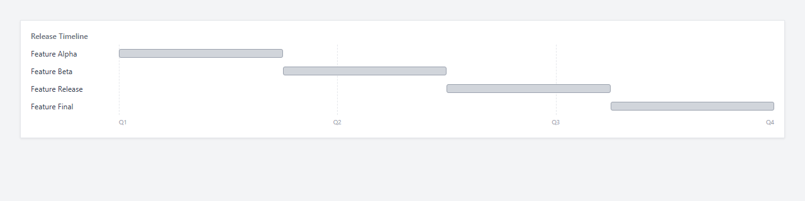
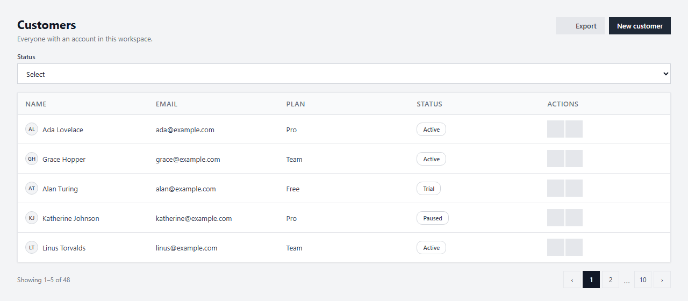
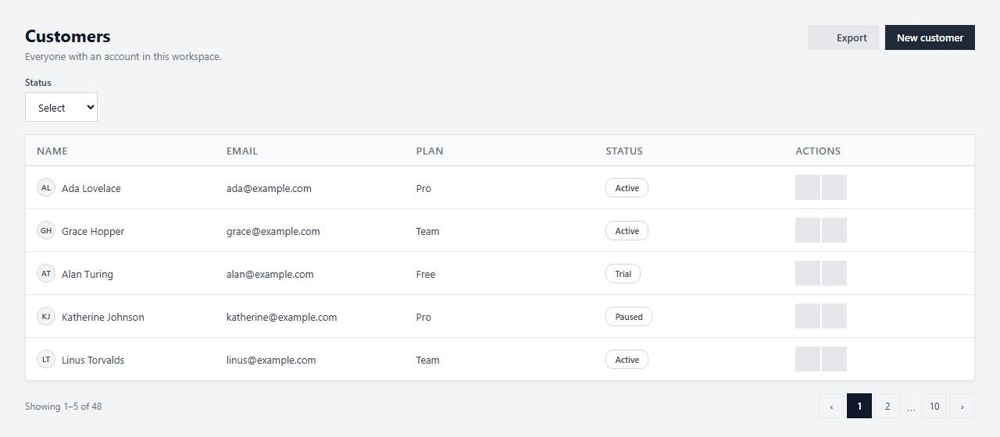

# Gantt ticks and data page filters: before and after

Two items from the final iPad review. Before is `main` at `50ba721`; after is `claude/chart-filters`. Both images in each pair render the same YAML with Chromium headless shell 1243 on Minis, in card mode, `device: web`, in a 1280×900 viewport.

## Gantt bars and their ticks

The iPad's roadmap (four quarters, one bar per quarter) drew its bars across the Q2 and Q3 gridlines. The ticks were points spread evenly over the data, at 0, 1⅓, 2⅔ and 4, while the bars used the data's own scale.

| Before | After |
|---|---|
|  |  |

- **Fixture:** the `roadmap` chart from the review (`chartType: gantt`, `ticks: [Q1, Q2, Q3, Q4]`, bars 0–1, 1–2, 2–3 and 3–4), cropped to y 0–320.
- **What changed:** tick `i` now names the band from `i` to `i + 1` on the bars' scale. With ticks, the axis runs from 0 to the tick count, so `start: 0, end: 1` fills exactly the Q1 band. Gridlines mark the band edges, and each label is centred in its band.

## Filters in `std.data_page`

A single `select` passed to the `filters` slot spanned the whole page.

| Before | After |
|---|---|
|  |  |

- **Fixture:** `std.data_page` with `slots: { filters: [ select "Status" (Active, Pending, Inactive) ] }`, cropped to y 0–560.
- **What changed:** the slot sits in a filter bar, a row with `role: toolbar`. In a toolbar row a field keeps its natural width instead of growing up to 320 px, and the row wraps. The pattern's default filters keep their authored 280/160/160 px widths.
- **Line mode and an adaptive phone** are covered by the `line_chart_filters` gallery page and by `cli/test/chart-filters-browser.test.js`.
