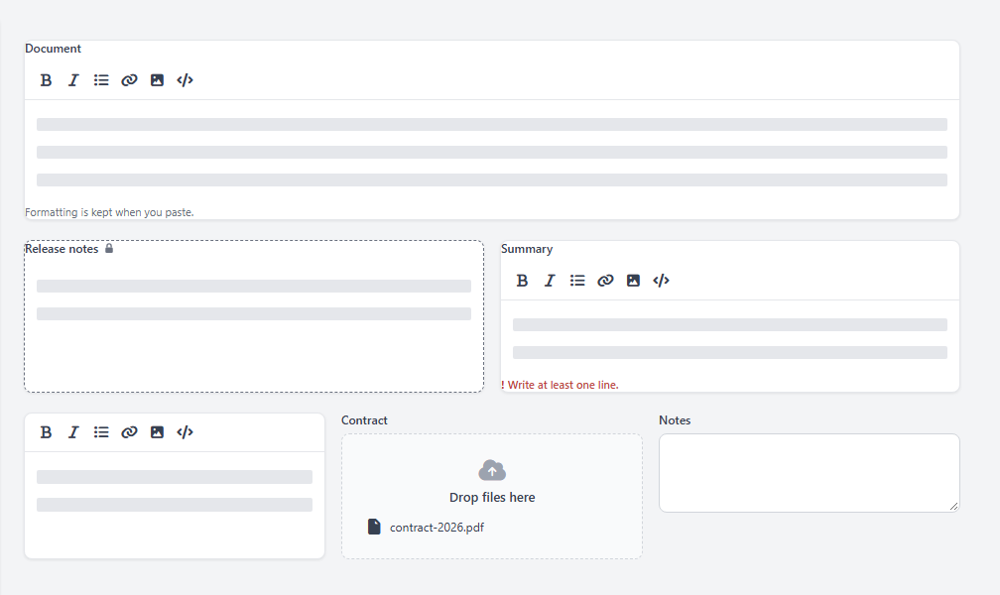
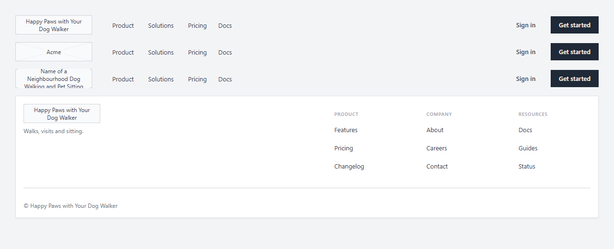
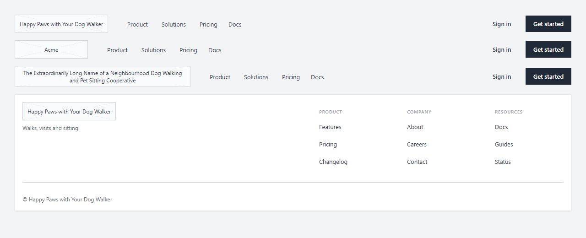

# Editor label: before and after

The iPad's `editor-1` review showed an `editor` with a label in card mode
(`device: web`) with "Document" pressed into the top-left corner of its card.
`editor` is self-padded, so its surface frame adds no inset, but its label,
help and error rendered inside that frame.

| Before (`main`, `5682e7f`) | After (`claude/editor-label`, `6b8eccd`) |
|---|---|
|  |  |

- **Fixture:** the gallery page `engine/renderer/__fixtures__/gallery/pages/field_frames.yaml`, card mode, `device: web`. Both images render the same YAML. The before image swaps in `main`'s two renderer files (`engine/renderer/primitives/controls.js` and `engine/renderer/styles/controls.js`).
- **Capture:** Chromium headless shell 1243 on Minis, viewport 1280×900, cropped to the content column (x 272–1280, y 0–600).
- **What changed:** with a label, help or an error the editor is a field. The label sits above a box holding the toolbar and body, and the note sits below it, as for the upload field form ("Contract") and the textarea ("Notes") on the same row. Read-only dashes the box and an error tones it. The editor without a label (bottom left) is unchanged.
- **Line mode** is covered by the `line_field_frames` gallery page and by `cli/test/editor-field-browser.test.js`.

## Site header and footer brand

On a 1280 px web page the iPad's `std.site_footer` drew "Happy Paws with Your Dog Walker" in a fixed 160×40 logo box, broken onto two cramped lines. `std.site_header` drew it the same way, and a longer brand was cut off.

| Before (`claude/editor-label` at `4fca6d2`, whose patterns and logo renderer match `main`) | After |
|---|---|
|  |  |

- **Fixture:** the content of the brand test in `cli/test/std-footer-browser.test.js`: three `std.site_header` rows (the iPad's brand, "Acme", and a brand longer than 24rem) and a `std.site_footer` with the iPad's brand, card mode, `device: web`. The before image swaps in the branch head's `engine/renderer/primitives/logo.js`, `site-header.js` and `site-footer.js`.
- **Capture:** Chromium headless shell 1243 on Minis, viewport 1280×900, cropped to y 0–520.
- **What changed:** without a skin logo and without an authored `width`, the logo box fits the brand on one line. It stays at least the old 160 px wide, so "Acme" is unchanged, and grows to at most `min(100%, 24rem)`. Past that it wraps and grows taller instead of clipping. The footer's brand column follows the box, from 240 to 384 px, and the tagline wraps to it. A logo with an authored width keeps its fixed box for every skin.
