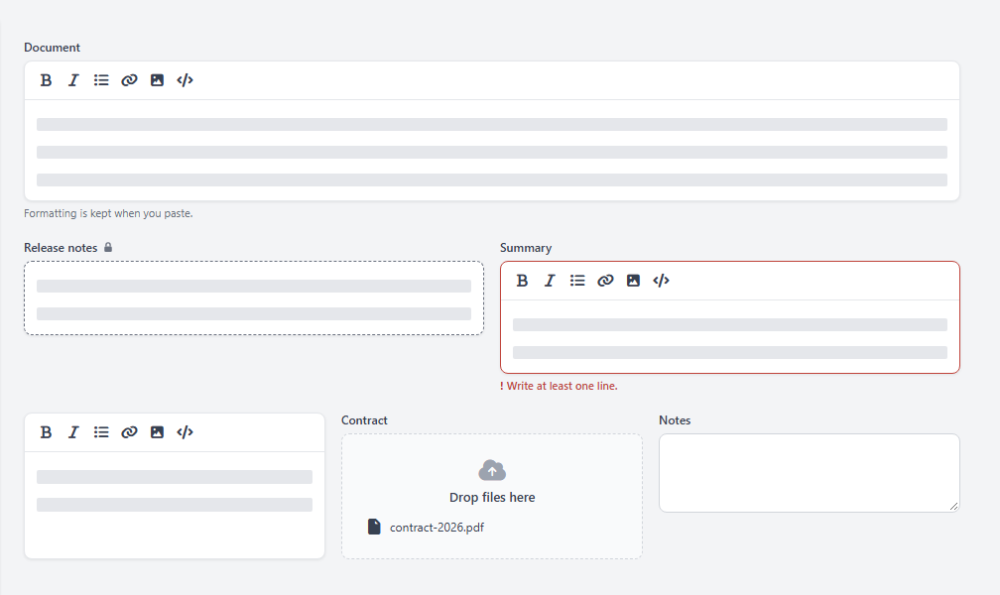

# Editor label: before and after

The iPad's `editor-1` review showed an `editor` with a label in card mode
(`device: web`) with "Document" pressed into the top-left corner of its card.
`editor` is self-padded, so its surface frame adds no inset, but its label,
help and error rendered inside that frame.

| Before (`main`, `5682e7f`) | After (`claude/editor-label`, `6b8eccd`) |
|---|---|
|  |  |

- **Fixture:** the gallery page `engine/renderer/__fixtures__/gallery/pages/field_frames.yaml`, card mode, `device: web`. Both images render the same YAML. The before image swaps in `main`'s two renderer files (`engine/renderer/primitives/controls.js` and `engine/renderer/styles/controls.js`).
- **Capture:** Chromium headless shell 1243 on Minis, viewport 1280×900, cropped to the content column (x 272–1280, y 0–600).
- **What changed:** with a label, help or an error the editor is a field. The label sits above a box holding the toolbar and body, and the note sits below it, as for the upload field form ("Contract") and the textarea ("Notes") on the same row. Read-only dashes the box and an error tones it. The editor without a label (bottom left) is unchanged.
- **Line mode** is covered by the `line_field_frames` gallery page and by `cli/test/editor-field-browser.test.js`.
