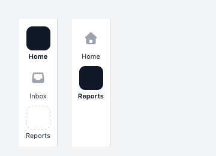
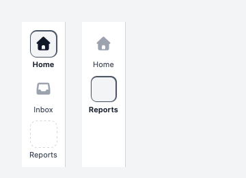

# Rail current tile: before and after

Five iPad screenshots showed the current item of a `nav variant: rail` as a dark filled tile whose icon could not be seen. The icon was ink on an ink tile, 1.00:1. `.wf-nav-on .wf-icon-glyph` paints the glyph ink for the sidebar's light current row, and the tile's own light colour named an undefined token.

| Before (`main`, `9734850`) | After (`claude/rail-contrast`) |
|---|---|
|  |  |

- **Fixture:** two rails, card mode, `device: web`, built to disk so the icon font loads. On the left, the current item has an icon ("Home"). On the right, the current item has none ("Reports"), so its tile is the empty placeholder.
- **Capture:** Playwright WebKit 26.0, the proxy for the iPad's web view, on the Mac mini, 1280×600 viewport cropped to 360×260. The before image uses `main`'s `engine/renderer/styles/navigation.js`.
- **What changed:** the current tile is plain. It takes the sidebar's light current fill in card mode (none in line mode) inside a strong 1.5 px solid edge (`--wf-line-strong`), so it stays distinct from the dashed placeholder tiles.

| Measured (WebKit and Chromium, web and adaptive phone) | Before | After, card | After, line |
|---|---|---|---|
| Icon against the current tile (needs 3:1) | 1.00:1 | 16.12:1 | 17.74:1 |
| Current tile's edge against the rail (needs 3:1) | none | 7.56:1 | 7.56:1 |
| Current label against the rail, under the tile (needs 4.5:1) | 17.74:1 | 17.74:1 | 17.74:1 |

`cli/test/rail-contrast-browser.test.js` computes these ratios in both engines, modes and sizes.
