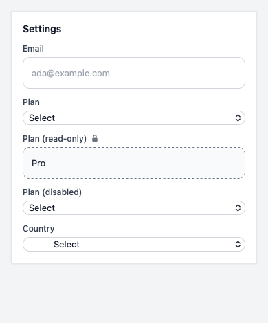
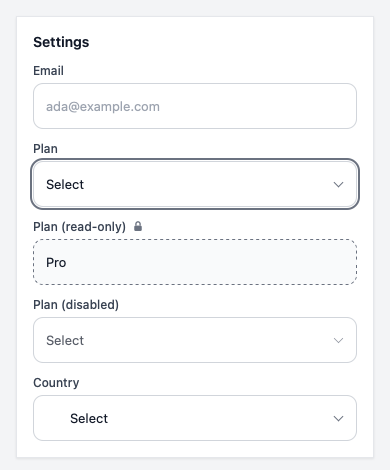

# Select height: before and after

On the iPad (WKWebView), a `select` drew shorter than the `input` above it, so a settings form with Email then Plan looked uneven. WebKit's native menulist ignores `min-height`, so the shared control height never reached it. Chromium honours it, so the gallery's Chromium baselines never showed the problem.

| Before (`main`, `136dfaf`) | After (`claude/select-height`) |
|---|---|
|  |  |

- **Fixture:** a settings card with an Email `input` and four selects: Plan, Plan read-only, Plan disabled, and a searchable Country. Card mode, adaptive phone (`device: mobile`, portrait), 390×900 viewport.
- **Capture:** Playwright WebKit 26.0, the proxy for the iPad's web view, on the Mac mini, cropped to 390×470. The before image is `main`'s `engine/renderer/styles/controls.js`.
- **What changed:** a single `select` is drawn with `appearance: none` at the shared control height, with its own chevron, so it is exactly as tall as an input: 44 px on a phone, 36 px on the web. A read-only select draws no chevron. A disabled select and its chevron dim to 0.7, which is what Chromium's native select did. A `multiple` select stays a native list box. The field box also shows a 2 px focus ring; before, neither inputs nor selects showed any focus.
- **Also covered:** Chromium, line mode and the web width, by `cli/test/select-height-browser.test.js`.
